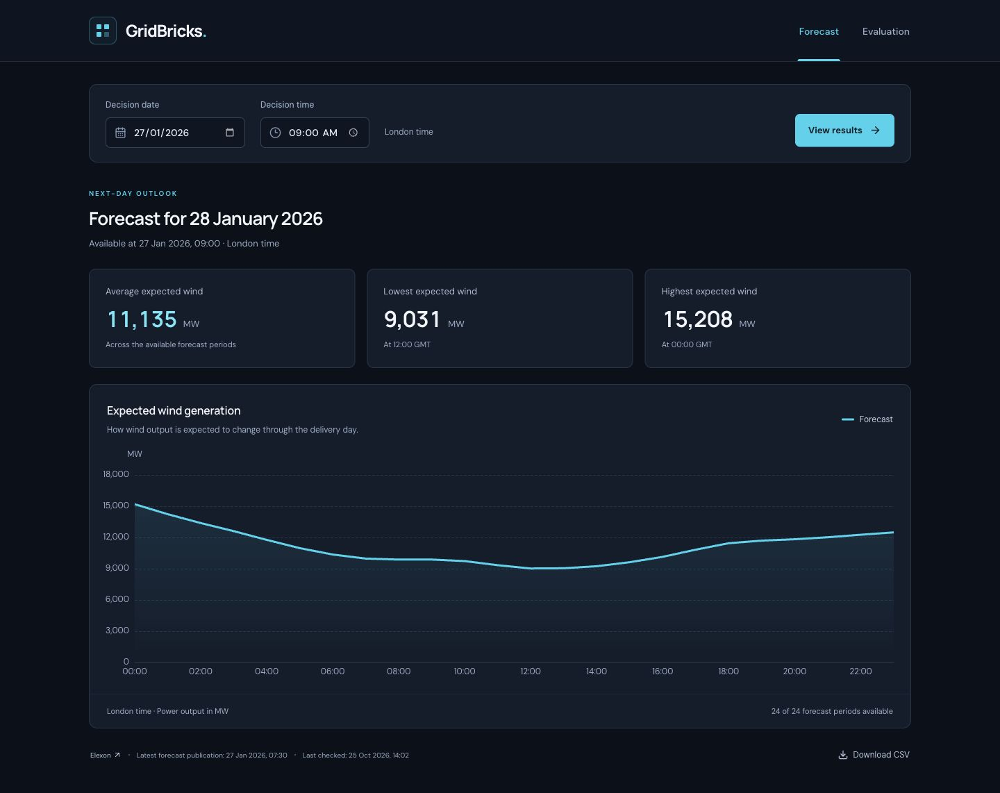

# Application and verification

## Application links

- Frontend: [gridbricks-wind.vercel.app](https://gridbricks-wind.vercel.app)
- Backend readiness: [gridbricks-api.onrender.com/health](https://gridbricks-api.onrender.com/health)
- Public source: [Sakshampoply/axzttscjdz](https://github.com/Sakshampoply/axzttscjdz)

The existing Git integrations build the `main` branch. Vercel hosts the React interface and Render hosts the Docker API and PostgreSQL. All existing Render resources remain on Free plans. The database expires **23 November 2026**; hosting limits are documented in [DEPLOYMENT.md](DEPLOYMENT.md).

## Refactored interface

One decision date/time controls exactly two tabs, **Forecast** and **Evaluation**. Both use the selected information cutoff. Each tab has three summary cards, one chart, a compact source status and CSV download. The default is 27 January 2026 at 09:00 London time.

## Verification on 25 October 2026

- Python tests include a real PostgreSQL database for concurrency checks; calculation, API, ingestion and saved-export tests pass.
- The frontend production build and Python lint checks pass.
- Browser verification covers native date/time edits, applying a selection, switching tabs, keyboard navigation and tooltip values.
- Unsubmitted edits do not change either report or exported CSV. Applying 31 January at 10:00 updates the forecast to 1 February and evaluation to the same cutoff.
- A deliberately unavailable local API displays a loading state and then a clear error, without retaining another selection's results. View results recovers when the API returns.
- Layout checks at 360, 390, 1280 and 1440 pixels show no horizontal page overflow. Mobile fields/cards stack; desktop cards form one row.
- Default evaluation: **705/705 completed targets**, MAE **1882.137589 MW**, bias **1495.774468 MW**. Its 30 earlier decision dates run from 28 December through 26 January; only outcomes known by 27 January at 09:00 are scored.
- An uncached early-January selection imports December through the durable queue. The 1 January at 09:00 evaluation reaches **705/705** completed targets after import.
- A forecast CSV downloaded from the browser contains 24 targets for 1 February, fixed to its applied 31 January 10:00 cutoff. The Evaluation CSV contains the matching completed-period evidence.
- Existing saved analyses remain readable. No database migration is required for this refactor.
