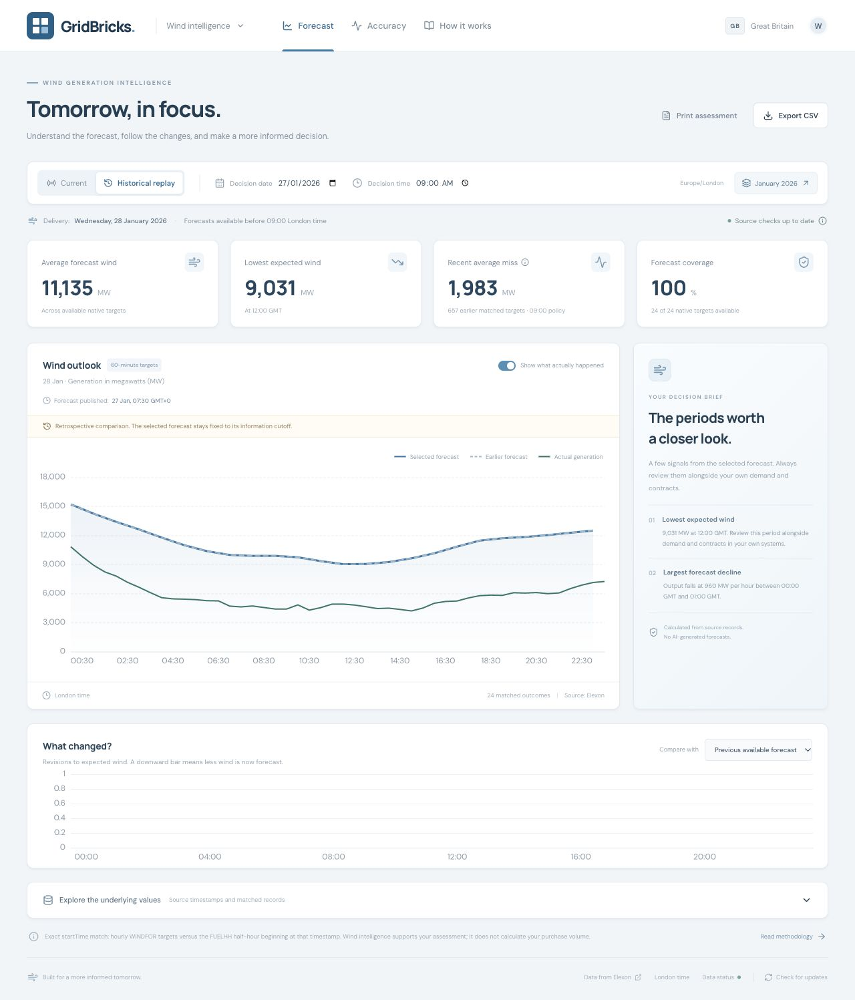

# Verified deployment status

Verified on 24 October 2026. All newly provisioned Render resources use the **Free** plan; Vercel uses the existing **Hobby** workspace. No paid worker or cron service was created.

| Deliverable | Result |
| --- | --- |
| Public application | [gridbricks-wind.vercel.app](https://gridbricks-wind.vercel.app) — deployed on Vercel, accessible in Chrome incognito |
| Public anonymous-name repository | [Sakshampoply/axzttscjdz](https://github.com/Sakshampoply/axzttscjdz) |
| Render Docker API | [gridbricks-api.onrender.com/health](https://gridbricks-api.onrender.com/health) — HTTP 200 |
| PostgreSQL 17 | Free instance in Frankfurt, private connections only; **expires 23 November 2026** |
| Scheduled synchronisation | GitHub workflow and `RENDER_API_URL` configured; manually dispatched run passed |
| Two-part walkthrough | [5-minute MP4](media/walkthrough.mp4), 2:37 customer overview + 2:27 technical review; YouTube upload awaiting user confirmation of upload terms |
| Assignment form | App/repository links prepared; not submitted. Requires video URL and user-provided name, email, phone, LinkedIn and public résumé link |

## Verification evidence

- **32 tests passed**, including actual PostgreSQL concurrency tests.
- [CI verification](https://github.com/Sakshampoply/axzttscjdz/actions/runs/40087254913) passed tests, frontend production build, Compose validation, and Docker image build.
- [Scheduled collection workflow](https://github.com/Sakshampoply/axzttscjdz/actions/runs/40087373713) accepted the hosted refresh while no browser was required.
- Hosted January 1–31 decision policy: **744/744** matched native hourly targets across 31 delivery days (January 2–February 1), MAE **2022.470430 MW**, RMSE **2497.407158 MW**, bias **1745.938172 MW**, WAPE **17.920954%**.
- Known-before-January-27-09:00 view: **609/744** matched outcomes. Future actual publications were excluded.
- Current October 25 delivery: **25** native hourly targets, including the London autumn clock change.
- Eight concurrent hosted refresh requests returned one shared job ID.
- Hosted CSV contained 24 replay targets and matched the selected snapshot; hidden actuals stayed hidden.
- Production CORS preflight returned the exact Vercel application origin.
- Browser checks covered current view, January replay, comparison publication, actual reveal, both accuracy bases, receipt replay, methodology, responsive layout, and CSV download.

The video uses captured application screens, technical diagrams, and synthetic narration. It does not include an impersonation of the applicant's voice. Free hosting has the limits described in [DEPLOYMENT.md](DEPLOYMENT.md); neither a five-minute SLA nor permanent free database availability is promised.
